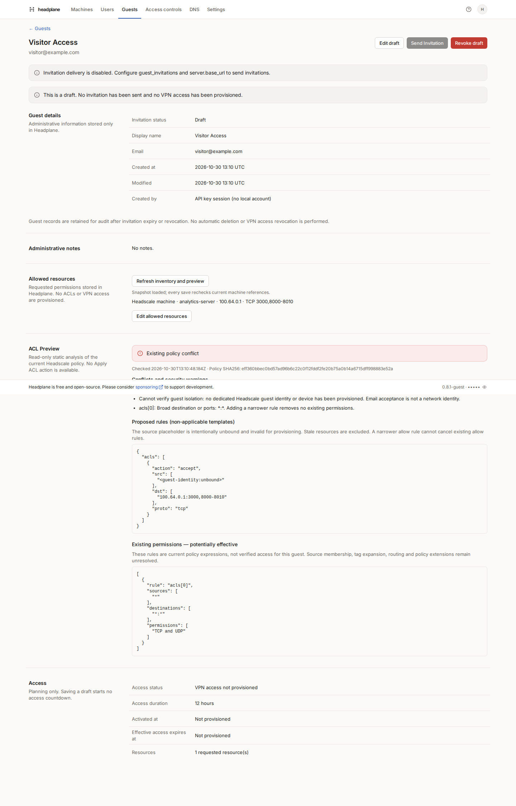
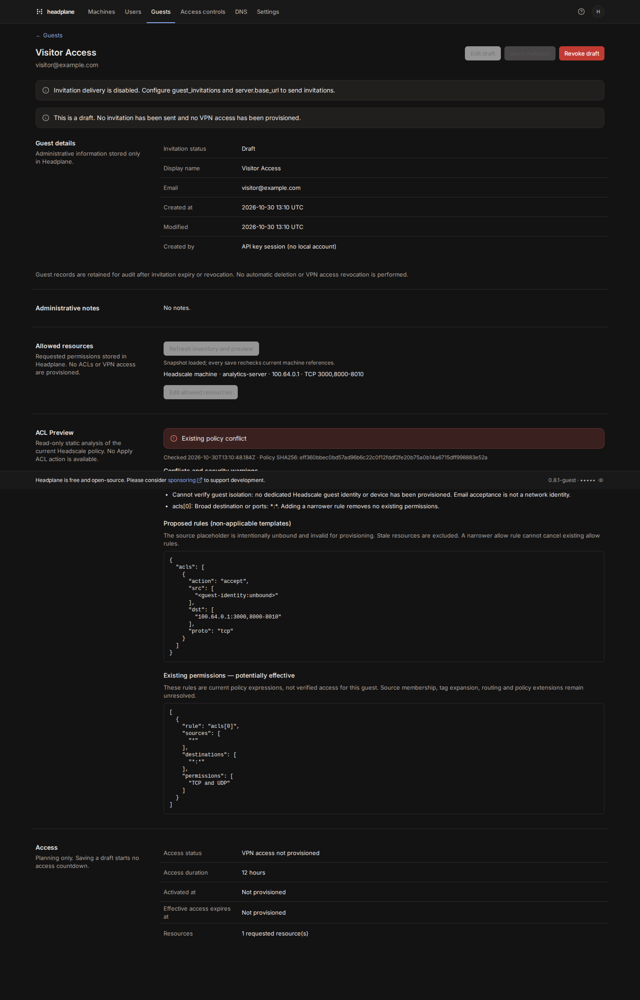
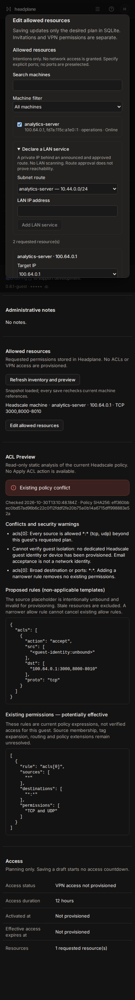

# Guest resources and ACL preview

Phase 3 stores desired resource permissions in Headplane. It does **not** write a
Headscale policy, create a user/key/device, approve routes, activate VPN access or
revoke network access. Invitation acceptance remains separate from provisioning.

## Select resources

Open **Guests → Add Guest**, or **Guest details → Edit allowed resources**.
Search machines by name, IP, owner or tag; filter online/offline or subnet routers.
Select machines, choose a current IP, protocol and explicit ports. Use **Add other
protocol** for a separate TCP/UDP intention. Remove a row or deselect its machine
to withdraw that intention. Save and reload to check persistence. No countdown
starts and no invitation is sent by saving resources.

A direct machine is identified by its Headscale ID plus a snapshot of its selected
IP. Names, ownership and tags are descriptive, not an authorization selector.
Deleted machines and changed addresses remain visible as stale intentions; they
are excluded from generated templates. Never silently transfer their permissions
to another address. An IP/ID snapshot is not yet a cryptographic device binding.

## Declare LAN services

LAN services are explicit administrator declarations, not discovered machines.
Expand **Declare a LAN service**, choose a subnet router/route and enter a literal
private IPv4 or IPv6 ULA address. The address must belong to that exact route,
which must be both currently announced and approved. Exit routes are excluded.
Headscale node IPs must be selected as direct machines, not LAN services.

Only RFC1918 IPv4 and IPv6 ULA destinations are supported in this phase. No DNS
aliases, public subnet services, LAN scan, interface discovery or routing changes
are performed. Overlapping routers do not establish end-to-end reachability. Route
approval, online state and advertisement do not verify forwarding, SNAT, return
paths, service availability or local firewalls. LAN intentions retain the router
ID, route and target IP; stale routes must be reselected explicitly.

## Port syntax and bounds

Use `22`, `22,443,8006` or `8000-8010`. TCP and UDP are separate rows. No wildcard,
implicit all-ports default or port zero is allowed. Each range contains at most
100 ports; each row allows at most 32 ranges and 256 ports, between 1 and 65535.
Duplicate/overlapping ranges and repeated target-IP/protocol rows are rejected.
A plan contains at most 50 rows. Inputs are validated on the client and server;
references are checked against a fresh API list before every resource write.

## Preview architecture and meaning

The loader reads machines and the current policy through the existing request's
Headscale client. It never calls a write endpoint. `guest-acl-preview.ts` reuses
the existing HuJSON parser and ACL destination syntax. TCP/UDP ACL templates work
with the supported Headscale versions; existing grants are analyzed too, with the
existing `policySupportsGrants` capability (Headscale 0.29+). Unknown versions are
explicitly uncertain. A missing/error policy is never replaced with empty/default
deny policy. The snapshot timestamp and SHA256 identify the analyzed policy; no
preview is a reservation against later policy changes.

The preview shows requested resources, non-applicable proposed rules, current
potential permissions, conflicts and uncertainties. It detects universal-source
rules that permit traffic beyond the plan, destination/port wildcards, possible
group/autogroup membership, shared tags, subnet dependencies and unsupported or
unmodeled policy extensions. Global rules already covered by the requested
protocol/ports are not classified as extra rights. User, tag, CIDR, SSH, via/app
and nested-group evaluation is deliberately incomplete and reported as such.

ACLs/grants are additive: a narrower new allow rule cannot cancel a broader
existing allow rule. A universal allow beyond the plan yields **Existing policy
conflict**. Other cases currently yield **Cannot verify guest isolation** because
no dedicated guest network identity exists. Email and invitation identity are not
Headscale identity. Source placeholders are intentionally unbound and not suitable
for application. **Ready for future provisioning** is intentionally unavailable
until identity binding and a complete effective-policy evaluation exist. There is
no Apply ACL action or enabled network-revocation button.

This is a conservative static review, not Headscale's complete policy compiler,
a packet simulator or proof of isolation. Analysis output is bounded to 100
warnings, conflicts and policy entries; truncation is explicitly uncertain. Policy
extensions or new syntax never produce an isolation guarantee.

References: [Headscale ACL policy](https://headscale.net/stable/ref/acls/),
[Tailscale ACL syntax](https://tailscale.com/docs/reference/syntax/policy-file),
[Tailscale grants](https://tailscale.com/docs/reference/syntax/grants).

## Storage, permissions and concurrency

Migration `20261030124826_guest_resources` adds only `guest_resources`, with:

- ULID `id`, guest foreign key, `kind` (`node`/`lan`), Headscale node/router ID.
- Canonical target IP, optional subnet route, protocol and normalized ports.
- Creation/update timestamps and per-row revision.
- Guest index, unique guest/IP/protocol index, kind/protocol/route/port-shape and
  positive-revision checks. Full port bounds and API references are enforced by
  the application, since SQLite has no Headscale inventory.

The guest revision is the compare-and-swap boundary for the entire plan, shared
with invitation edits/revocation. Replacements are transactional. Stable target
rows keep their ID and creation time; ports/protocol/address edits increment or
replace the relevant intention. Creation of a guest and its initial plan is one
transaction. A failed constraint restores the previous guest revision and rows.
Revoked guests cannot be edited. Accepted/pending invitations can retain editable
resource intentions while VPN access is unprovisioned. Resource timestamps are
not activation, expiry or revocation timestamps. No API keys are stored here.

All loaders/actions require existing `manage_guests` (owner/admin). Reading the
inventory/policy also checks the corresponding existing read permissions. New
resource writes require an explicit same-origin Origin, compatible with the
existing HTTPS runtime normalization, in addition to the normal React Router
transport protections. Both stale references and stale revisions fail closed.
The form payload is bounded, schema-validated and never interpolated into SQL.

## Migration, rollback and tests

Back up SQLite coherently and test on a copy. Startup's official migrator applies
the additive migration: fresh databases now have 12 migrations. Do not reset or
replace SQLite, change production configuration or apply migrations through raw
SQL/drizzle-kit push. Existing guest, invitation, auth and agent records remain.
Rollback returns to the prior binary with the additive table/history retained;
do not drop resources or automatically restore an older backup.

Run typecheck, lint, unit tests, build and the relevant integrations:

```sh
pnpm typecheck
pnpm lint
pnpm test:unit
pnpm build
HP_HEADSCALE_VERSIONS=all pnpm test:integration \
  tests/integration/headplane/guest-resources.test.ts \
  tests/integration/headplane/guests.test.ts \
  tests/integration/headplane/guest-invitations.test.ts \
  tests/integration/headplane/permissions.test.ts
HP_GUEST_BROWSER=1 HP_GUEST_SCREENSHOTS=docs/assets pnpm test:integration \
  tests/integration/headplane/guest-resources-browser.test.ts
```

Install Chromium with `pnpm exec playwright install chromium` first. All nodes,
policies and services in these tests are isolated harness fixtures. The scenario
compares actual Headscale state before/after Guest operations; deliberate fixture
setup/deletion is separate. The optional `HP_GUEST_MIGRATION_SOURCE` test opens a
provided SQLite source read-only, backs it up, and migrates only its temporary copy.





## Future provisioning and revocation contract

Provisioning needs a dedicated verified Headscale user/device binding, node key
fingerprints, an isolated source selector, explicit effective-policy proof,
version-aware compiler validation, and policy ownership/reconciliation. Re-read
machine addresses, routes, guest/access revisions, intended duration and policy
hash at activation. Refuse an elapsed absolute deadline; start relative duration
only on confirmed activation. Keep effective grants and their audit history in a
separate model from desired resource rows. Record durable idempotent operations
and failures; never report success before verification.

- **Revoke Invitation**: existing local token/session/challenge invalidation only.
- **Revoke Guest Access**: future removal of owned ACL/grant permissions, followed
  by effective-policy verification; unrelated shared rules must not retain access.
- **Expire Guest Access**: the same verified withdrawal, driven by a durable job
  using effective activation/expiry, independent of invitation validity.
- **Revoke Device**: future expiry/deletion through the node API with a verified
  device binding. This is distinct from removing policy permissions or invitations.

No implementation of these Headscale writes is included in Phase 3. Policy
replacement, lost updates, group/tag inheritance, alternate paths and existing
connections all need explicit treatment before claiming immediate revocation.
