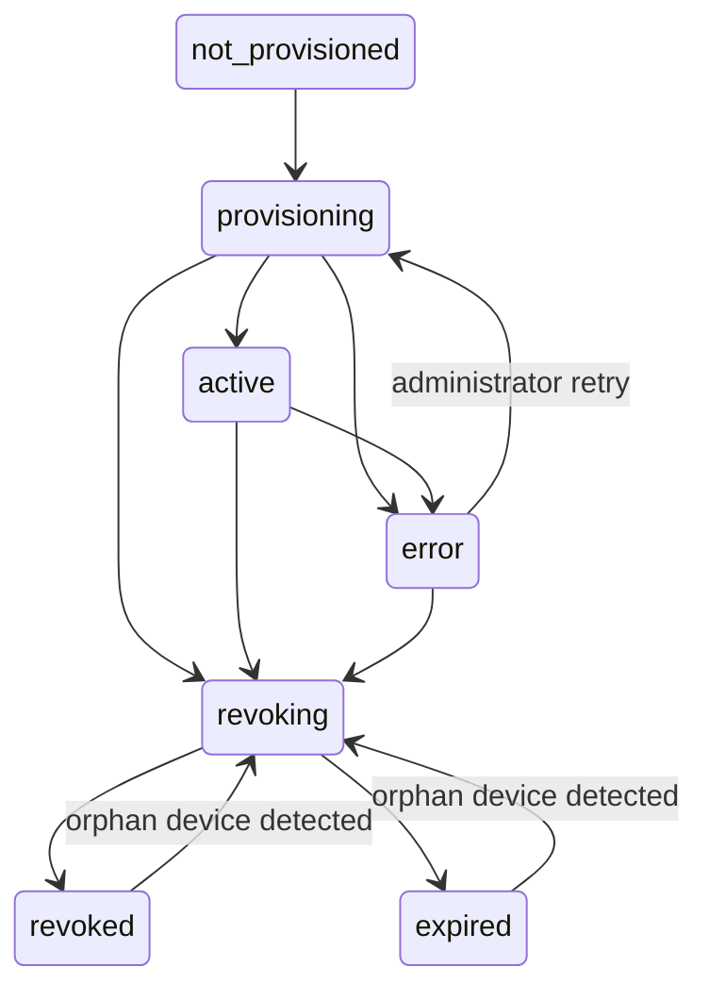
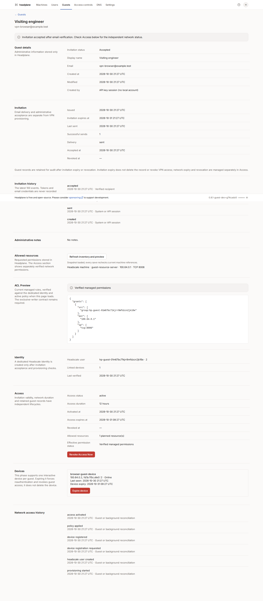
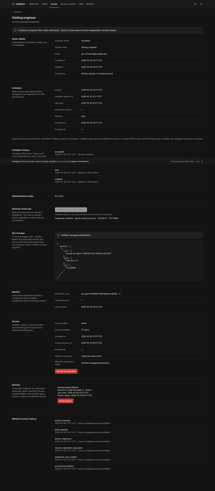
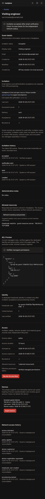

import { versions } from "@/lib/versions";

Guest records, invitation acceptance and network access have separate lifecycles.
Creating a draft or accepting an invitation does not grant network permissions.
Network provisioning is disabled by default.

## Prerequisites and policy ownership

Use a stable Headscale {versions.headscale.guestVpn} release, or an explicitly audited and approved custom build of that minor, with database policy mode. Create and validate a restrictive initial policy before enabling Guest provisioning. The network
scenarios are tested on the harness version in `tests/harness/versions.ts`;
Older supported Headscale releases remain available for administrative Guest
features, but Guest VPN provisioning is unavailable. Unknown versions, prereleases and modified builds
are refused for provisioning. Establish clock synchronization on both services.

Require Headplane to be the **only policy writer**. Stop independent policy
automation and prohibit direct CLI, API, database and file policy edits during
Guest access. Multiple Headplane processes must share the same SQLite database
and server secret. Independent databases do not coordinate locks.

Headscale's policy API has no expected-revision field or HTTP ETag. A shared
lease plus hash checks cannot protect against an external writer racing a PUT.
The exclusive-writer contract is an operational prerequisite, not an enforced
Headscale authorization boundary. Do not enable this feature if that contract
cannot be maintained. A privileged external operator can also change users,
tags, nodes or routes; reconciliation detects these changes after the fact.

Configure the development instance explicitly:

```yaml
guest_vpn:
  enabled: true
  single_policy_writer: true

guest_invitations:
  enabled: true
  transport: file
```

Retain a server-side `headscale.api_key` through the existing protected secret
file mechanism. Recovery and expiry cannot depend on an administrator's browser
session. Set `headscale.public_url` if the browser-facing coordination URL differs
from the internal API URL. Keep the existing invitation configuration, public
HTTPS URL and secure cookies. Use the file transport during isolated validation;
real SMTP delivery requires separate operator authorization.

### Custom Headscale builds

Unknown versions and prereleases remain blocked. A `+dirty` suffix, other build
metadata or a `dirty: true` response never enables provisioning implicitly.
Audit the executable, its commit, API schema and isolated network behavior first.
Keep the executable's SHA-256 separately as evidence of the local binary tested.

Configure an exact approval in the server configuration only:

```yaml
headscale:
  compatibility:
    approved_builds:
      - version: "0.29.6"
        commit: "a2b1d7863926834e94479dcdd91ab344a9356bd0"
        fingerprint: "161a320779fb4e60fe2166b8ce3e9cc468a669643c2675b2e6ba9e9ed6a32312"
```

This example identifies one audited build; it is not a recommendation to trust
another executable with that version. The fingerprint is SHA-256 over compact
UTF-8 JSON of the ordered array
`["headscale-build-v1", versionWithoutLeadingV, commit, buildTime, dirty, go.version, go.os, go.arch]`.
Preserve prerelease/build suffixes in the version. Require the full lowercase
40-hex commit, UTC build time, boolean dirty flag and nonempty toolchain/platform
fields from `/version`; incomplete custom metadata cannot be approved.

Changing any metadata requires a new audit and explicit approval. Provisioning
and registration re-read `/version`, reject an unapproved or replaced server,
and log acceptance without credentials. Revocation and reconciliation retain
durable cleanup requests during outages. Restart Headplane after an approved
server replacement. The allowlist is never returned to Guest browsers.

These are **reported metadata**, not remote cryptographic attestation. Protect
the API connection with trusted TLS and restrict privileged access to Headscale.
An approval does not authorize unsupported minors, unknown builds or prereleases.
Headplane generally still supports 0.27+, but Guest VPN requires 0.29: 0.27/0.28
lack the JSON Auth ID registration and policy-check endpoints used by this flow.
The multiversion suite retains these older servers and checks that Guest
provisioning makes no changes on them.

## Administrator workflow

1. Create a Guest with explicit resources, TCP/UDP ports and access duration.
2. Send and accept the invitation using its separate email verification code.
3. Refresh Guest Details and select **Provision Access**. Confirm the operation.
4. Wait for the dedicated identity and **awaiting device** state. This step adds
   no permissions and starts no relative countdown.
5. Complete device registration from the verified Guest browser session.
6. Check the Access, Identity, Devices and Network access history sections.

The confirmation is bound to the Guest revision, duration, selected resources,
resource ownership/tags/routes and current canonical policy. Recalculate these
values before preparation and activation. A changed preview blocks the operation;
refresh Guest Details and explicitly approve again. A Guest cannot accept that
change through the device portal. Volatile telemetry and unrelated new devices
do not invalidate a decision.

Each Guest receives a reserved `hp-guest-<guest-id>` local Headscale user with a
persisted recovery marker. Never share that identity with a Headplane account
or assign it tags. Register its devices only through the portal; never mint
independent keys or change its ownership/expiry through other tools. Existing conflicting identities are refused. A lost create
response can be reconciled by stable name, ID and marker; email is not the
technical identifier.

This phase supports one authenticated interactive device per Guest. An expired
device record is retained. An uncertain registration is neutralized and flagged
for review rather than automatically adopted. Previously accepted invitations
whose verified browser session has expired require a new invitation/Guest
workflow; this phase does not add an email-based portal sign-in flow.

## Guest onboarding

The accepted invitation offers **Continue to device onboarding**. The portal
uses a signed HttpOnly cookie containing an opaque, hashed, 24-hour session.
It shows only that Guest's state and device. It does not grant dashboard access.

Install the official Tailscale client for Windows, macOS or Linux through a
trusted distribution channel. Configure the custom coordination server or run
the displayed `tailscale up --login-server ...` command in PowerShell or a
terminal, with local administrator privileges when required. Trust the
coordination server's certificate through the operating system; do not disable
TLS verification.

A single `tailscaled` instance switches coordination servers; it does not keep
the official Tailscale tailnet and this Headscale tailnet connected simultaneously.
Perform laptop validation with physical access or a separate recovery connection.
Record the original account/control-server choice before switching. Use
`sudo tailscale login --login-server=<isolated-test-server>` on Linux; follow the
platform client's custom-control-server flow elsewhere. Expect a temporary loss
of the original tailnet connection. To return, sign out of the test connection
and sign in to the original account at `https://controlplane.tailscale.com` using
the platform client or `sudo tailscale login --login-server=https://controlplane.tailscale.com`.
Confirm the original tailnet before ending the maintenance window. Never send
an Auth ID or full registration URL to chat, public logs or screenshots.

Submit the Auth ID printed by the registration page. Treat it as a bearer
device-registration credential. The portal email session establishes Guest
identity; the Auth ID authorizes association of the device presented by that
session. It does not independently establish physical device ownership. Submit
only an Auth ID from the intended personal device. A durable global hash claim
prevents a submitted Auth ID from being reused or claimed by another Guest.
Headscale confirms the final immutable user ID, node ID and machine identity.
Requests use `/api/v1/auth/register` with a JSON body, never an Auth ID URL.

Public responses, including session errors, use no-store, restrictive referrer policy and same-origin
resources. Mutations require Origin, a session-bound CSRF value and persisted
rate limiting. URL-encoded public forms are bounded by actual bytes even without
Content-Length, and duplicate credential fields are refused. The Auth ID is not retained in cleartext or included in audit.

## Isolation and managed rules

The provisioning verifier is separate from the planning-only ACL Preview.
It rejects duplicate JSON keys, invalid policy entries, unknown sections,
unresolved selectors, broad Guest membership, tag acquisition, cyclic groups,
SSH rules and automatic route approvals. Unsupported syntax is a blocker, not
an ignored warning. Empty or unavailable policy is not assumed to deny access.

The verifier accepts only a conservatively understood policy subset. A rule
that already authorizes the Guest outside its exact managed rules blocks
provisioning with **Guest isolation cannot be guaranteed**. Ordinary rules for
other explicit users or inaccessible tags are retained, including their broad
destinations. The proof concerns Guest-initiated TCP/UDP flows; it does not
analyze application-layer relays on an allowed service or guarantee availability.

Use Grants when the existing document contains Grants; otherwise retain ACLs.
Never convert the complete policy. A deterministic `group:hp-guest-<guest-id>`
contains exactly the dedicated user. Generated rules use literal selected
addresses, explicit ports/ranges and TCP or UDP. There is no generated wildcard.
SQLite stores exact managed rules. Collisions or manual changes to those rules
block replacement/removal rather than risk deleting manual policy.

LAN intentions remain distinct from Headscale machines. Revalidate the selected
router, literal private address and exact announced **and approved** route at
provisioning and reconciliation. This feature creates no LAN route, router or
route approval. LAN forwarding, SNAT, service identity and return-path reachability
remain operator responsibilities; no scan or assertion of physical LAN isolation
is made. Resource IP changes, node deletion and route changes trigger neutralization
when detected. Monitoring has a ten-second polling interval plus API latency.

## Durable operations and concurrency

Migration 14, after Local Auth, adds `guest_vpn_access`, `guest_vpn_devices`,
`guest_vpn_auth_claims`, `guest_vpn_sessions`, `guest_vpn_events` and
`guest_vpn_policy_state`. It preserves the first thirteen migrations and all
existing rows. Guest records keep their original draft/revoked semantics;
network timestamps and states live in `guest_vpn_access`.
The persisted preview hash binds preparation to subsequent activation. Keep
these additive tables and migration history when rolling back the application;
verify all Guest access revoked first. The supported upgrade baseline is the
deployed Local Auth schema. Earlier unmerged VPN fixtures are outside that
upgrade path; run the harness with a fresh disposable database.

The access state machine is:



All Headplane policy writers, including the ACL editor and user-group editor,
share a 120-second SQLite lease. Every network step checks ownership. API calls
have a 15-second timeout. Save the before-image and candidate before sending a
policy PUT, validate through Headscale's policy-check endpoint, compare the
current canonical SHA256 immediately before writing and verify the read-back.
The ACL editor includes its loaded revision. Candidate verification preserves
every existing Guest's managed rules and rejects new broadened permissions.

A restart recovers a candidate confirmed as actually applied. If the previous
policy is still present after an uncertain request, **do not resend**: an earlier
request might still be in flight. Keep the journal blocked for operator review.
An interrupted activation never becomes active merely because a rule is present;
neutralize it and require administrator retry. Persisted attempts and bounded
backoff survive process restarts. SQLite failures never imply successful access.

For policy drift, block writes and expire verified Guest devices. Review the
external change in a controlled maintenance window with all policy writers
stopped and Guest devices expired. Restore the last verified managed policy
from the operator's policy backup, or repair the journal/baseline only after
checking the active policy and device expirations. Do not clear a pending journal
while any write could be in flight. No automatic rollback overwrites external
policy. Keep the before-image for review rather than treating it as a restore
command. Unrecognized users/devices are flagged, never adopted automatically.
Late identity-creation results are linked only when the persisted recovery
marker matches. A new authenticated device under a retained revoked/expired
Guest identity reopens cleanup, expires the device and records an orphan event;
it never reactivates Guest access. Ordinary manual users/devices are left alone.

## Duration, expiry and revocation

Set and verify a native Headscale node expiry **before** applying any Guest
permission. Confirm the policy and final node expiry before setting access
active. A relative duration starts at verified activation. An absolute UTC
deadline never moves; a deadline reached during onboarding blocks activation.
Native key expiry bounds access during a Headplane outage. The persistent worker
also removes managed permissions and records the expired state.
Go zero-times and missing device expiry mean **no expiry**, not successful
revocation. They cannot satisfy a revocation confirmation.

Select **Revoke Access Now** to remove the exact generated rules, expire the
Guest's devices and verify both results. A failure remains revoking/error and
offers retry; no successful revocation is reported. Select **Expire device** to
force reauthentication; for this single-device phase it also revokes Guest
permissions. Neither operation deletes a node, user, invitation or Guest record.
**Revoke Invitation** remains a separate pre-acceptance operation.

Confirmation is against Headscale's control plane, not an acknowledgement from
every client. Packet-filter updates require propagation. The network scenarios
verify that new TCP/UDP traffic and an already-open TCP stream stop; they do not
claim zero propagation latency or availability during a control-plane partition.

Resource intentions are frozen while an access record may still grant rights.
Revoke and verify access before editing them. Terminal access records cannot
be reactivated automatically. Preserve audit and create a new Guest workflow
when new access is required. Retention/purge is a separate future policy.

Reconciliation checks user markers, stable ownership, device identities and
expiry, resource references/routes and the managed policy. Drift neutralizes
verified devices, removes unchanged managed rules when safe and displays a
sanitized error. Network/API failures retain retry state. The audit includes
identity creation, registration, policy application/removal, activation,
revocation, expiry and error codes without credentials or raw Auth IDs.

## Validation and future deployment

Run `pnpm typecheck`, `pnpm lint`, `pnpm test:unit`, `pnpm build` and the
Guest network integration tests. Set `HP_HEADSCALE_VERSIONS=all` for the
supported matrix. Browser scenarios are opt-in with `HP_GUEST_BROWSER=1`.
Use `HP_GUEST_MIGRATION_SOURCE` only with a protected, coherent development
copy: the migration test makes another copy and compares existing table hashes.
Never point development services at the deployed data directory or tailnet.

The isolated scenarios cover both ACLs and Grants, permitted/forbidden TCP and
UDP ports, a declared LAN service behind an approved router, cross-Guest denial,
native expiry without a worker, immediate administrative expiry/revocation,
lost replies, API outages, restart recovery, orphan devices and policy drift.
Browser validation covers email verification, the scoped portal, a real process
restart, CSRF, revocation and responsive light/dark layouts. Windows/macOS client
instructions are provided; native desktop execution is not exercised by the
Linux Chromium harness.





Before a future deployment, back up SQLite through its backup API, test schema
13 → 14 on a copy, retain the policy and existing native release, and obtain
explicit activation approval. Keep provisioning disabled until the actual
Headscale build and exclusive-writer contract are validated. Do not disable the
feature, remove its API key or downgrade while non-terminal accesses remain;
startup rejects such a configuration. Revoke and verify all accesses first.
A binary rollback does not remove network rules or reverse the additive migration.
Do not restore SQLite over newer invitations or network-operation history.

The immutable `v0.8.1-guest` tag is unchanged. This phase creates no release and
does not deploy or modify the existing tailnet.

See the [native validation record](/guest-vpn-validation-2026-10-30) for the
audited artifact, API comparison, network scenarios and remaining laptop gate.

The LAN-only `http://192.168.0.120:8085` test endpoint is not a final deployment
target. Prepare stable DNS such as `https://headscale.example.com`, a valid TLS
certificate, matching Headscale `server_url` and a reviewed external-access plan
before any later exposure. This validation deploys none of those infrastructure
changes.
